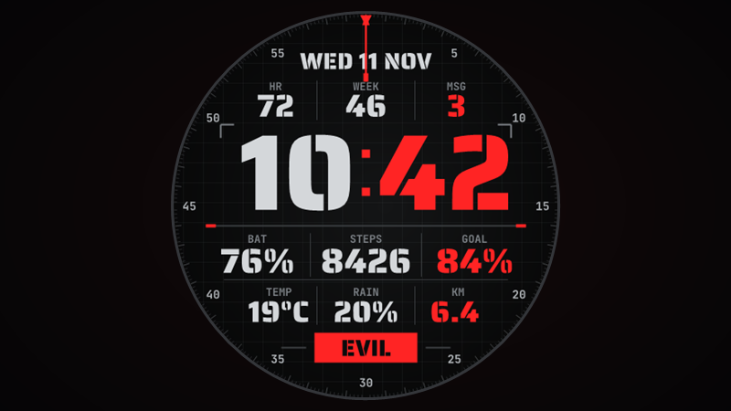

# EVIL — watch face for Wear OS

A military-style data face for round Wear OS watches (built for the OnePlus Watch 3, 466×466). Two-tone stencil time, a red chrono seconds hand sweeping the minute bezel, and nine live data fields.

<p align="center"></p>

<p align="center"></p>

The animation is rendered from the face's own layers.

## What it shows

| Row | Fields |
| --- | --- |
| Top | date · heart rate · week number · unread notifications |
| Centre | time (follows the 12/24 h system setting) |
| Middle | battery · steps · step goal % |
| Bottom | temperature · chance of rain · distance walked (km, estimated from steps) |

A stripped-down always-on (ambient) layout keeps only the time.

Values change colour with their state: heart rate is grey under 100, amber from 100 and red from 140; the message count is red only while something is unread; the battery label turns into a red CHG on the charger and the value goes red at 20 % or less. Distance uses 0.78 m per step.

Notes from the OnePlus Watch 3: heart rate shows `--` until the sensor has a reading (it reports 0 between measurements). The system weather source always returns 0 for UV there, so that field was replaced by distance.

## How it is built

Pure [Watch Face Format v2](https://developer.android.com/training/wearables/wff) — the APK contains resources only, no code.

- `tools/gen-evil.ps1` generates `res/raw/watchface.xml` and the bitmap layers. Edit the script, not the XML.
- `build.ps1` builds the APK without Gradle (aapt2 → zipalign → apksigner, debug key).
- `tools/measure-cpu.ps1` measures the watch face runtime's CPU use over adb.

```powershell
.\build.ps1                     # build\orbit.apk
.\build.ps1 -Install            # build + adb install on the connected watch
```

Requires the Android SDK (build-tools 37, platform android-34) and a JDK.

## Install

Grab the APK from [Releases](../../releases) and sideload it:

```
adb install orbit.apk
```

Then long-press the current watch face and pick **EVIL**. Needs Wear OS 4 or newer.

Fonts: Saira Stencil One and a bold monospace, both under the SIL Open Font License.
